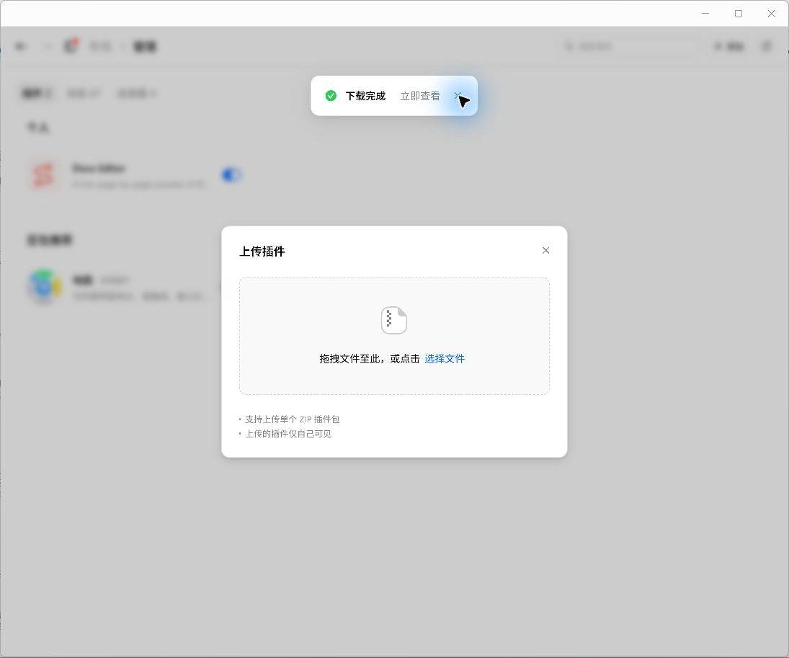
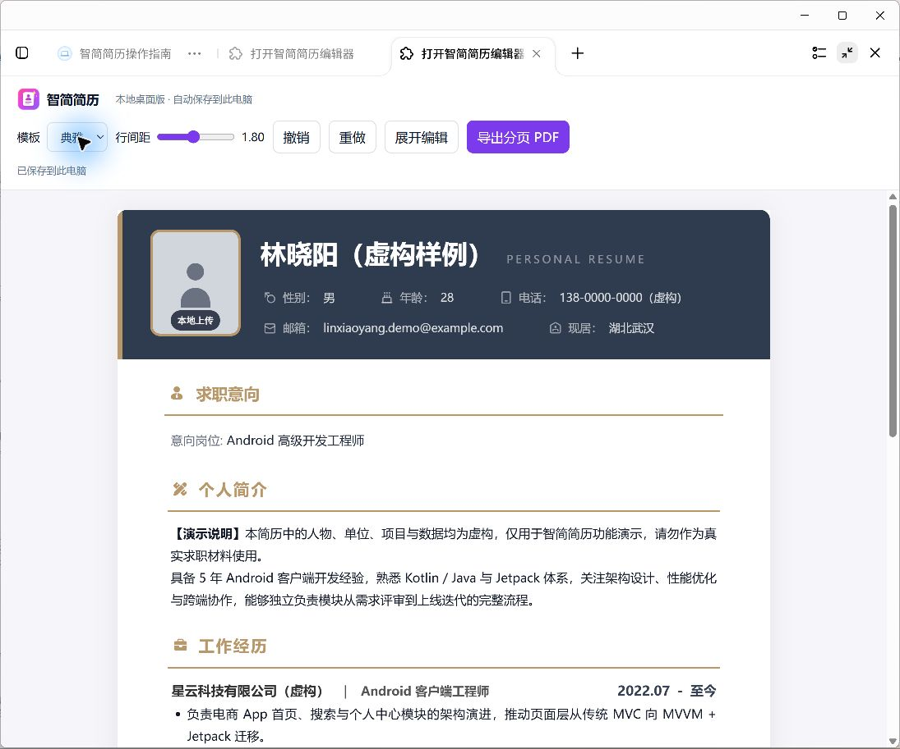

# 智简简历


由 [智简简历（aijianli.cn）](https://aijianli.cn/?utm_source=github&utm_medium=readme&utm_campaign=resume_plugin) 开发者维护的开源本地简历编辑器，复用官网编辑器的交互与排版能力。官网提供在线简历制作，本项目提供独立的本地桌面插件。

**[下载本地插件](https://github.com/meyhuan/zhijian-resume-plugin/releases/latest)** · **[无需安装，在线制作简历](https://aijianli.cn/import?utm_source=github&utm_medium=readme&utm_campaign=resume_plugin)**

在支持 MCP Apps 的 AI 桌面客户端内直接编辑简历：修改内容、切换模板、调整行距、导出分页 PDF。复用 React／Lexical 编辑器，使用本地 STDIO MCP，不需要部署网站、公网服务器或 ngrok。

**Windows 已验收 · macOS 适配待桌面端验收 · Apache-2.0**

## 本地插件还是网页版？

| 需求 | 本地开源插件 | [智简简历网页版](https://aijianli.cn) |
|---|---|---|
| 使用入口 | 支持本地 MCP Apps 的桌面客户端；豆包 Windows x64 可上传 ZIP | 浏览器访问，无需安装本插件 |
| 编辑与排版 | 简约、典雅两套模板，内容编辑与行距调整 | 在线编辑与模板选择 |
| 导出 | 本机 Chrome / Edge 生成分页 PDF | PDF、可编辑 Word 等，按网站账号权益使用 |
| 保存 | 本机草稿，不提供账号同步 | 网站账号内保存 |
| 适合谁 | 想在 AI 桌面会话里编辑，或研究、修改源码的用户 | 想直接粘贴 AI 文本排版，或需要 Word 导出的用户 |

两者不会自动同步简历。开源许可证适用于本仓库自有代码，不代表网站服务免费无限使用；网站权益请查看[价格说明](https://aijianli.cn/pricing)。插件不内置云 AI 服务，模型能力与使用限制由宿主提供。它不是豆包或 OpenAI 官方产品。

## 功能

- 简历内容编辑、简约／典雅两套模板、行间距调整、撤销重做。
- 本机草稿自动保存，版本冲突检测。
- 本机 Chrome／Edge 生成 A4 分页 PDF，内嵌预览并交由宿主下载。
- 独立项目：无原网站账号、支付、数据库、OSS 或云 AI API 依赖。

## 快速开始

**豆包 Windows x64：**从 [最新 Release](https://github.com/meyhuan/zhijian-resume-plugin/releases/latest) 下载 `zhijian-resume-<版本>-doubao-win-x64.zip`，直接在 **插件 → 添加 → 上传插件** 中拖入安装，不解压、不单独安装 Node、不填写路径。新建“本地电脑”工作任务，让豆包使用 `zhijian-resume-desktop` 创建简历并打开编辑器。PDF 导出需要本机 Edge 或 Chrome。详见 [豆包接入说明](docs/doubao.md)。

下载后可在 PowerShell 中运行 `Get-FileHash .\zhijian-resume-0.4.0-doubao-win-x64.zip -Algorithm SHA256`，与 Release 附带的 `.sha256` 文件比对。

**macOS（ChatGPT／Codex）：**参见 [macOS 接入说明](docs/macos.md)。发布安装包前，可从源码构建并注册本地插件。

**Windows（ChatGPT 或手动连接器）：**

1. 安装 [Node.js 22.13+](https://nodejs.org/)，确保本机有 Chrome 或 Edge。
2. 从 [Releases](https://github.com/meyhuan/zhijian-resume-plugin/releases) 下载 Windows ZIP，完整解压；也可下载源码并安装。
3. 双击 **`install.cmd`**，选择 Local／豆包、ChatGPT 或 Both。
4. 根据 [ChatGPT 接入说明](docs/chatgpt.md) 或 [豆包接入说明](docs/doubao.md) 启用插件。
5. 新建本地工作会话，要求模型“使用 zhijian-resume 创建简历并打开编辑器”。

上述备用安装器检查依赖，将运行文件复制到当前用户目录并生成本机绝对路径配置。豆包采用此手动方式才需复制参数；ChatGPT 注册依赖支持 `codex plugin` 的 CLI。详见 [Windows 安装、升级与卸载](docs/windows.md)。

## 复制这句话开始

```text
请用智简简历创建一份虚构的中文求职简历，并打开内嵌编辑器，让我修改内容、切换模板、调整行间距并导出分页 PDF。
```

用真实资料创建简历时，将“虚构的中文求职简历”替换为“基于以下真实资料的简历”，并附上资料。

## 安装与编辑截图





截图仅包含虚构演示资料。当前豆包插件列表会按技术标识显示 `Zhijian Resume` 与默认图标；编辑器内展示“智简简历”及品牌图标。清单已提供中文名称和图标字段，豆包暂未采用这些展示字段。

## 宿主兼容性

| 宿主 | 本地工具 | 内嵌编辑器 | 状态 |
|---|---|---|---|
| 支持本地插件的 ChatGPT／Codex 桌面环境 | STDIO MCP | MCP Apps | 已完成本机实际编辑与 3 页 PDF 下载验收 |
| 豆包 Windows 电脑版“本地电脑”任务 | ZIP 上传，内置 Node + STDIO | MCP Apps | 已实际安装，完成编辑、模板、行距、保存及 5 页 PDF 下载验收 |
| macOS ChatGPT／Codex | 本地插件市场 + STDIO | 需要 MCP Apps | 已添加安装包及自动化验证流程，桌面宿主待验收 |
| 豆包 macOS | 可尝试手动 STDIO | 需要 MCP Apps | 待验证 |
| 普通 chatgpt.com 网页远程连接器 | 本方案不适用 | — | 不提供公网服务 |
| 其它 MCP 客户端 | 取决于客户端 | 还需支持 MCP Apps 与文件下载 | 未验证 |

宿主功能受版本和账号能力影响，安装器不能为不支持本地插件的客户端增加能力。仅有 MCP 工具调用并不等于支持交互界面。验收范围见 [测试记录](TEST-REPORT.md)。

## 本地运行与隐私

插件不监听 HTTP 端口。宿主启动 Node 子进程，通过 stdin/stdout 调用工具并加载单文件 HTML。草稿保存在当前用户目录，具体路径见 [数据与权限](docs/privacy.md)。PDF 渲染阶段阻断网络请求。

模型对话、宿主沙箱与首次依赖安装仍可能联网，**不代表整个 AI 客户端完全离线**。草稿明文保存，.zresume 含访问凭据；不要公开分享。详见 [数据与权限](docs/privacy.md)。

## 开发

```powershell
npm ci
npm run build
npm run typecheck
npm test
npm run test:ui
npm run smoke
npm run test:install
```

`npm run release:doubao` 构建豆包上传 ZIP 和 SHA256，`npm run test:doubao-package` 验证无系统 Node 的运行链路。`npm run release:windows` 构建 Windows 备用安装器，`npm run release:macos` 构建 macOS 插件包。维护者流程见 [发布说明](docs/releasing.md)。项目保持 `private: true` 防止误发 npm；不影响源代码的开源授权。

| 目录 | 用途 |
|---|---|
| `server/` | STDIO MCP、草稿存储、鉴权、PDF 渲染 |
| `web/` | MCP Apps 桥接、编辑器外壳、PDF 预览 |
| `src/` | 从原项目抽取的编辑器与两套模板依赖 |
| `scripts/` | 构建、桌面安装、许可证和发布打包 |
| `tests/` | 协议、存储、UI、PDF 和安装测试 |
| `docs/` | 接入、隐私、排错、发布文档 |

已知范围：只保留两套模板；PDF 传输上限 6 MB；无草稿列表、跨机同步或自动更新；.zresume 文件入口依赖 OpenAI 扩展，不作为跨宿主通用入口。

## 授权与贡献

项目自有代码采用 [Apache License 2.0](LICENSE)，参见 [NOTICE](NOTICE)。编辑器源自项目所有者的 resume-builder-nextjs，已抽取为独立应用；DOCX Editor 仅作架构参考，没有分发其商业编辑器。第三方组件保留各自授权，完整声明见 [THIRD_PARTY_NOTICES.md](THIRD_PARTY_NOTICES.md)。本项目不是 OpenAI 或豆包官方产品。

[贡献指南](CONTRIBUTING.md) · [安全报告](SECURITY.md) · [常见问题](docs/troubleshooting.md) · [更新记录](CHANGELOG.md)
